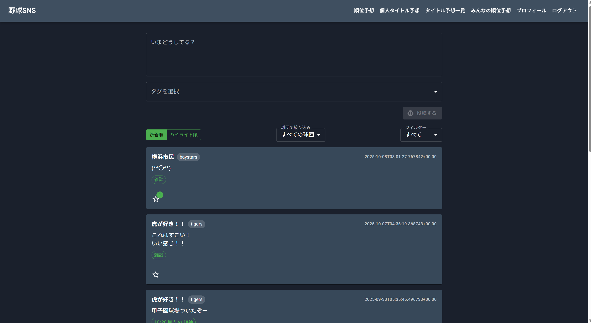
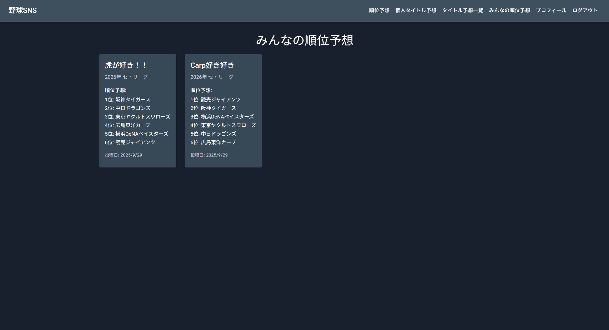
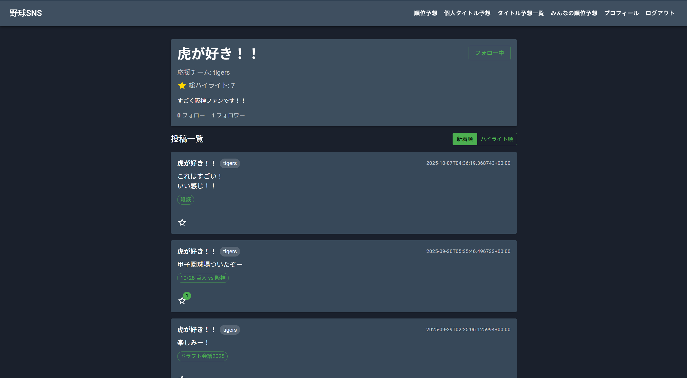

# my-grad-work-2025
野球好きのためのSNS（卒業制作）# Baseball SNS

> 野球好きのためだけに作られた、熱狂を共有し、保存するための次世代SNSアプリケーション。

X (旧Twitter) などの汎用SNSでは、野球の話題が他の情報に埋もれたり、逆にノイズが混じってきたりします。また、試合ごとの熱狂やシーズン前の予想といった貴重なファンの声も、タイムラインの波に飲まれ、すぐに流れていってしまいます。<br>
`Baseball SNS`は、独自の「統制されたタグシステム」を核とすることで、野球ファンのための快適で熱中できるコミュニティ空間を提供します。

## 📸 スクリーンショット

<!-- 
ここにスクリーンショットを挿入してください。
GitHubリポジトリに画像をアップロードし、そのURLを `` の形式で記述するのがおすすめです。
横に並べたい場合は、HTMLの<table>タグを使うと綺麗にレイアウトできます。
-->

| タイムライン | 順位予想 | プロフィール |
|:---:|:---:|:---:|
|  |  |  |


## ✨ 主な機能一覧

### SNS基本機能
- **ユーザー認証:** 新規登録、ログイン、ログアウト (Supabase Auth)
- **投稿:** テキストによる投稿機能
- **タイムライン:** 全ユーザーの投稿を時系列で表示
- **プロフィール編集:** 表示名、応援球団、自己紹介文の更新

### コミュニティ機能
- **ユーザープロフィールページ:** 他のユーザーの情報と過去の投稿を閲覧
- **フォロー/フォロワー:** 他のユーザーをフォローし、関係性を構築
- **ハイライト:** 投稿に対する評価機能（1ユーザー1回制限）

### ⚾ 野球特化機能
- **統制されたタグシステム:** 投稿時に「試合」や「雑談」などの定義済みタグを選択必須
- **順位予想:** ドラッグ＆ドロップによる直感的なUIでのリーグ順位予想
- **個人タイトル予想:** MVPや新人王などの個人タイトル予想

### ユーティリティ機能
- **ソート＆フィルター:** タイムラインを「新着順/ハイライト順」「応援球団」「期間」で動的に絞り込み・並び替え
- **インタラクティブUI:** `Framer Motion`によるアニメーション、`dnd-kit`によるドラッグ＆ドロップ
- **品質・堅牢性:** ローディング表示、フォームバリデーション、404ページなどのエラーハンドリング
- **レスポンシブデザイン:** スマートフォン表示への対応

## 💡 こだわりの実装ポイント

### 1. 統制されたタグシステム
Xのハッシュタグとは異なり、運営が定義したタグのみを選択させることで、情報の氾濫と分散を防ぎます。これにより、ユーザーはノイズのない環境で、自分が見たい話題に関する投稿に的確にアクセスできる、質の高い情報体験を実現しました。

### 2. バックエンド処理の最適化 (RPCの活用)
プロフィールページの表示や、複雑な条件での投稿フィルタリングなど、複数のデータを必要とする場面では、フロントエンドからのリクエスト回数を最小限に抑えるため、Supabaseの**データベース関数 (RPC)** を積極的に活用しました。
「必要な情報を全てまとめて返す」専門の関数をバックエンドに用意することで、高速で効率的なデータ取得と、フロントエンドのコードの簡潔性を両立させています。

### 3. RLSによる堅牢なセキュリティ
「自分のプロフィールは自分しか編集できない」「投稿やハイライトの作成・削除は本人しか行えない」といった重要なアクセスルールを、すべてデータベースレベルで強制する**行レベルセキュリティ (RLS)** を各テーブルに設定。これにより、フロントエンドの不備に依らず、データの安全性が根本から担保されたセキュアなアプリケーションを構築しました。

## 🛠️ 使用技術 (技術スタック)

### フロントエンド
- **React 18** (UIライブラリ)
- **Vite** (ビルドツール)
- **MUI (Material-UI)** (UIコンポーネントライブラリ)
- **React Router** (ルーティング)
- **Framer Motion** (アニメーション)
- **dnd-kit** (ドラッグ＆ドロップ)

### バックエンド & インフラ
- **Supabase** (BaaS - Backend as a Service)
  - **Auth:** ユーザー認証
  - **PostgreSQL Database:** データストレージ
  - **RLS (Row Level Security):** データアクセス制御
  - **Database Functions (RPC):** サーバーサイドロジック
  - **Database Triggers, Views:** データ自動化・集計

### 開発環境
- **Node.js**
- **npm**
- **Git / GitHub**

## 🚀 ローカル環境での実行方法

1.  このリポジトリをクローンします。
    ```bash
    git clone https://github.com/【あなたのGitHubユーザー名】/【あなたのリポジトリ名】.git
    ```
2.  ディレクトリを移動します。
    ```bash
    cd 【あなたのリポジトリ名】
    ```
3.  依存関係をインストールします。
    ```bash
    npm install
    ```
4.  プロジェクトのルートに`.env.local`ファイルを作成し、SupabaseのプロジェクトURLとAnonキーを設定します。
    ```.env.local
    VITE_SUPABASE_URL="YOUR_SUPABASE_URL"
    VITE_SUPABASE_ANON_KEY="YOUR_SUPABASE_ANON_KEY"
    ```
5.  開発サーバーを起動します。
    ```bash
    npm run dev
    ```
6.  ブラウザで `http://localhost:5173` にアクセスします。

---

_This project was created as a graduation project._
